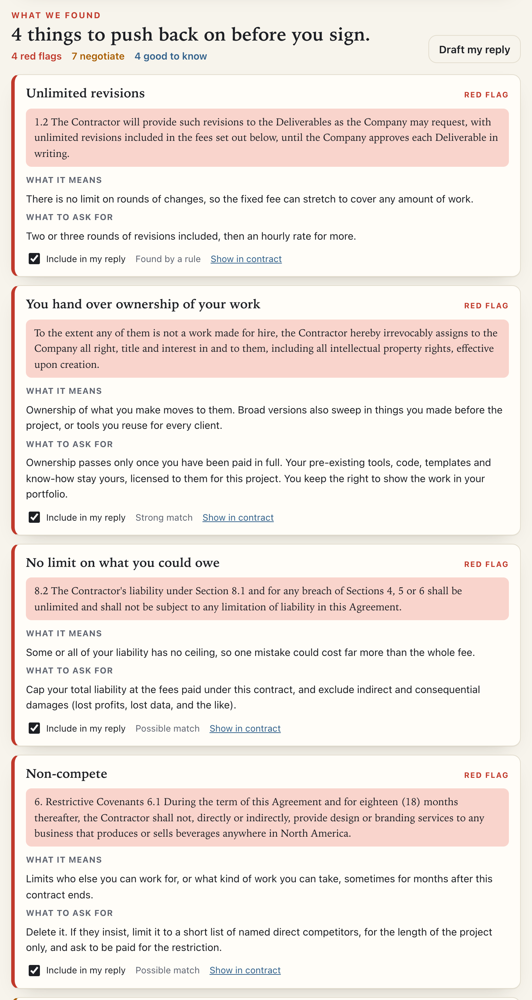
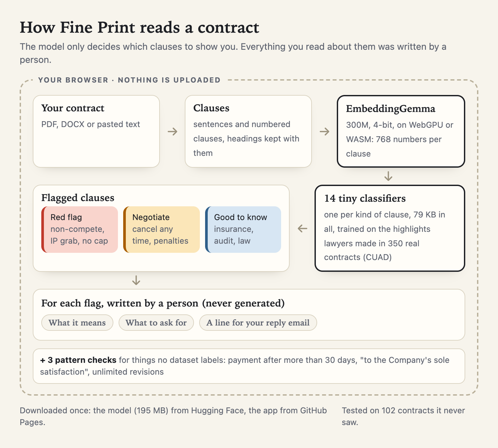

# ClauseGuard 🔍

**Freelance Contract Red-Flag Finder.** Formerly called Fine Print.

Finds the clauses in a client contract that cost freelancers money, before you sign it.

Paste the contract or drop in the PDF. **EmbeddingGemma**, Google's open-weight embedding model, reads every clause in your browser, and a small classifier trained on 350 contracts that lawyers had marked up flags the ones to worry about: non-competes, IP grabs, no cap on what you could owe, penalties, auto-renewal, cancel-at-any-time and more. Each flag comes with what it means, what to ask for and wording to suggest instead. **Write a counter-proposal** drafts a polite email about one clause, and **Draft my reply** writes one email covering every clause you tick.

For freelancers in India working for clients abroad, **cross-border checks** add nine more: payment that could outlast the nine months RBI allows, ownership that passes before you are paid, disputes settled abroad, currency, transfer fees and withheld tax, how far a non-compete reaches, and unpaid cancellation.

A **browser extension** runs the same check on a contract open in Google Docs or DocuSign. **Not legal advice.**

**Live:** https://vanshajpoonia.github.io/fine-print/



## Why it runs on your device

Client contracts are confidential, often explicitly. Many say so in their own confidentiality clause, and pasting one into a hosted AI service means handing it to a third party. ClauseGuard never has the contract: the model is a file your browser downloads once, and the text never leaves the tab. Open the network tab and check.

It is also what makes this a viable one-person business. A tool that never receives its customers' contracts has nothing to leak, nothing to secure, and no per-scan cost, so it can be priced like a tool rather than like a lawyer.

## How it works



```
contract (paste, PDF, DOCX) ──► clauses ──► EmbeddingGemma (q4, in the browser) ──► 768 numbers per clause
                                src/segment.js   src/embed.js                              │
                                                                                            ▼
                        14 tiny classifiers, one per kind of clause (data/heads.json, 79 KB)
                        trained on CUAD's lawyer highlights by scripts/train.mjs
                                                                                            │
                                                                                            ▼
     flagged clauses ──► what it means, what to ask for, wording to suggest: written by a person (src/flags.js)
     + 3 pattern checks CUAD has no category for: payment terms over 30 days, "to the Company's
       sole satisfaction", unlimited revisions (src/rules.js)
     + 9 cross-border pattern checks, when switched on (src/crossborder.js)
     ──► counter-proposal emails, filled in from templates on the device (src/letters.js)
```

- **The model finds; people wrote the advice.** Nothing a freelancer reads is generated. A small model explaining a legal clause in its own words is exactly where you do not want invention, so the AI's only job is deciding which clauses to show you, and that job can be measured.
- **Segmentation** (`src/segment.js`) has to handle two very different inputs: real documents with hard-wrapped lines, and CUAD, where every contract is one long line with all whitespace collapsed. It splits on sentences and numbered clauses, keeps headings ("Non-Competition.") attached to their clause, and keeps offsets so the app can highlight the exact text.
- **The classifiers** are one logistic regression per flag on top of the embeddings, trained in plain JavaScript (`scripts/linear.mjs`), with each threshold chosen on validation contracts. In the browser, scoring a clause is 14 dot products.
- **Two builds of the same model.** On WebGPU the browser runs exactly the 4-bit file the tests measure. That file's quantised token lookup is missing from the browser's WASM runtime, so browsers without WebGPU load a sibling 4-bit build that keeps the lookup table unquantised. `node scripts/fallback.mjs` compares them on 2,936 test clauses: mean cosine between their vectors 0.9955, and **36 of 41,104 flag decisions differ (0.09%)**; the fallback raises slightly fewer flags (653 against 673).

## Data

[CUAD](https://www.atticusprojectai.org/cuad) (Contract Understanding Atticus Dataset, The Atticus Project, CC BY 4.0) is 510 real commercial contracts from SEC filings, with clauses in 41 categories highlighted by lawyers and law students. ClauseGuard's 14 flags use 16 of those categories (`src/flags.js` lists which). CUAD's official split is used as is: the 408 training contracts are split again into 350 to fit on and 58 to choose thresholds on, and the **102 test contracts are only used to test**.

## Measured

`npm test` runs the real model over all 102 held-out contracts (20,671 clauses, 824 of them highlighted by lawyers under one of the 14 flags) and scores three approaches the same way:

| Approach | Clauses found | Flags that were right | False alarms per contract | Contracts: found / right |
|---|---|---|---|---|
| Ctrl+F (hand-written keyword patterns) | 49% | 29% | 10.5 | 71% / 70% |
| Zero-shot (similarity to a one-line description) | 38% | 7% | 44.3 | 69% / 56% |
| **Trained heads on EmbeddingGemma (shipped)** | **66%** | **56%** | **4.6** | **83% / 78%** |
| Same training on bge-small (a sixth of the size) | 60% | 48% | 5.5 | 81% / 74% |

"Contracts: found / right" is the question a freelancer actually asks: does this contract have a non-compete? Of contracts where the lawyers marked one, how often ClauseGuard says so, and when it says so, how often it is right.

By flag (shipped):

| Flag | Clauses found | Right | Contracts found / right |
|---|---|---|---|
| Whose law, and where | 86/90 | 91% | 96% / 100% |
| No limit on what you could owe | 15/16 | 32% | 100% / 38% |
| You must carry insurance | 104/116 | 60% | 94% / 94% |
| Renews itself | 26/35 | 62% | 85% / 70% |
| They can inspect your records | 76/104 | 50% | 84% / 82% |
| Non-compete | 40/57 | 44% | 87% / 65% |
| There is a liability cap | 72/117 | 65% | 91% / 87% |
| Exclusivity | 41/78 | 43% | 76% / 78% |
| No-poach, no-solicit | 15/30 | 88% | 69% / 90% |
| They can cancel at any time | 18/41 | 49% | 62% / 69% |
| You can't criticise them | 5/12 | 35% | 71% / 36% |
| You give up the right to challenge them | 18/44 | 37% | 75% / 90% |
| You hand over ownership of your work | 22/61 | 61% | 74% / 74% |
| Fixed penalties | 5/23 | 38% | 36% / 63% |

What the table teaches:

- **Zero-shot is not a shortcut.** Describing a non-compete in one sentence and looking for similar clauses finds some, and drowns them in 44 false alarms per contract: to an embedding model, all legalese is similar to all other legalese.
- **Ctrl+F is a real baseline.** "governed by" finds governing law clauses fine. It falls apart on anything said in more than one way: a covenant not to sue is "shall not challenge", "shall not contest", "will not attack".
- **The bigger model earned its place where it matters most.** With identical training, bge-small (a sixth of the size) found 60% of clauses against EmbeddingGemma's 66%, but only 44% of non-compete clauses against 70%.
- **It is weakest on penalties and IP**, partly because CUAD's categories are broader than a freelancer's worry: its "IP ownership assignment" includes transferring domain names between companies.

### Not every false alarm is false

CUAD's annotators often highlight one instance of a clause per contract, so some "false alarms" are real clauses they did not mark. `node scripts/audit.mjs 40` prints 40 at random. Reading them: **8** are plainly the right kind of clause (a liability cap, an insurance requirement, an audit right), **12** are next to one (its heading, a carve-out, a recital), and **20** are plain mistakes (a press-release quote flagged as exclusivity). Every number above still counts all of them as wrong.

## Cross-border checks for freelancers in India

Switched on by default, and off with one tick. Nine pattern checks in `src/crossborder.js`, each with what it means in plain words, what to ask for, and wording to suggest instead:

| Check | What it looks for |
|---|---|
| No date for getting paid | Fees, but no number of days to pay them in |
| Nothing happens if they pay late | A due date, but no late fee, interest or right to pause work |
| Payment could take longer than RBI allows | Paid when they are paid, a holdback, payment on launch or funding, or over 270 days |
| They own the work before they pay for it | "Hereby assigns", "upon creation", "work made for hire", "will assign" with nothing tying it to payment |
| Disputes are settled abroad | Courts, arbitration or governing law outside India |
| Which currency, at whose rate | "$" with no currency named, no currency at all, or an exchange rate they choose |
| Transfer fees or tax come out of your pay | Bank, transfer or platform fees on you, or tax withheld from payments |
| Non-compete reaches too far | Restrictions that last after the contract, cover a whole region, or any business in the field |
| Cancelled work goes unpaid | If it ends early, only accepted work is paid, or nothing is owed |

A narrower check replaces the model's broader flag on the same clause, so a non-compete shows once, with its reach in the title.

**The RBI rule.** Since 1 October 2026, money for exported services has to reach India within **nine months of the invoice date**, or twelve if invoiced or settled in rupees. Your bank can extend that if you ask with reasons. It was fifteen months until the change. Source: RBI, Foreign Exchange Management (Export and Import of Goods and Services) Regulations, 2026, regulation 5(1), [as amended up to 2 November 2026](https://www.rbi.org.in/Scripts/NotificationUser.aspx?Id=13277&Mode=0), and the [amendment of 22 September 2026](https://m.rbi.org.in/scripts/BS_FemaNotifications.aspx?Id=13714) that cut fifteen months to nine.

### Measured

`node tests/crossborder.mjs` (part of `npm test`):

- **Written fixtures.** 72 clauses that should be flagged and 72 that should not, used while writing the checks: all 72 found, no false alarms. Then 45 and 45 more, written afterwards and run once before any change: **37 of 45 found (82%), false alarms on 2 of 45 (4%)**. The checks have changed since, and these fresh clauses now give 37 of 45 and 2 of 45. The misses are printed, so you can see what each check cannot read yet.
- **Indian freelance phrasing.** Payment clauses as Indian freelancers meet them: Upwork-style milestone terms, agency subcontracts paid "on realisation from the End Client", rupees, lakh and TDS. Two hand-written sets of 30 should-flag and 30 should-not, for the five payment checks and unpaid cancellation. One was used to tune the checks: 17 of 30 found and 3 false alarms before, 30 and 0 after. The other was only measured: **18 of 30 found (60%) and 1 false alarm before the tuning, 20 of 30 (67%) and 1 after**. Its misses are printed too. The RBI check does worst there, finding 1 of 5.
- **Whole contracts.** The cross-border sample in the app trips exactly the eight checks it was written to trip. A fair contract (`tests/fixtures/fair.txt`) trips none.
- **CUAD's 102 held-out contracts**, where a CUAD category covers the check. Disputes abroad finds 82 of 90 governing-law clauses (91%). Ownership before payment finds 16 of 61 IP assignment clauses (26%), and 16 of its 20 flags (80%) are on one. Non-compete reach finds 10 of 59 non-competes (17%), and 9 of its 15 flags (60%) are on one. Both skip clauses on purpose: assignments that wait for payment, and narrow non-competes.
- **Read by hand.** The other checks have no CUAD category, so `node scripts/audit-rules.mjs` prints a random sample of each one's flags on those same contracts to read. On a sample not used while tuning (`SEED=202`, and `SEED=303` for the late-fee check after a bug fix), the flag was on the right kind of clause in: disputes abroad 10 of 10, ownership 9 of 10, currency 6 of 10 (`SEED=505`, after the Indian-phrasing changes), late fee 7 of 10, fees and tax 6 of 10, non-compete reach 6 of 10, no payment date 3 of 10, unpaid cancellation 0 of 1 (its only flag was a bribery clause). The RBI check raises nothing on CUAD. These are company-to-company contracts, so payment terms in them look little like a freelancer's, and the payment checks do worst there.

## Counter-proposal emails

Every card has **Write a counter-proposal**, and **Draft my reply** writes one email for all the cards you tick. Nothing is generated by a model. Each flag carries a polite reason and wording to suggest, written by a person, and `src/letters.js` fills them in on the device with:

- the clause's section number, found by looking back to the nearest numbered clause when the flagged sentence is not the first one;
- a quote of the clause, cut at a word boundary;
- what the check found, such as "12 months after the contract ends, anywhere in the world";
- the contract's own names for each side, taken from its definitions, such as "the Company" and "the Developer";
- what a suggested percentage comes to on the contract's fee, written the way the contract writes money: a 25% kill fee on "USD 14,000" is "USD 3,500", and 1.5% a month on "₹1,40,000" is "₹2,100". `src/money.js` reads USD, $, US$, INR, Rs., ₹, EUR, GBP and words like "US dollars" or "rupees", Indian grouping such as 1,40,000, and lakh and crore. It takes the total fee, not an insurance limit, a milestone or a rate per hour, and adds nothing when it cannot tell. Checked in `tests/unit.mjs`.

Brackets like `[30]` mark numbers to choose. Every draft starts with a line saying it is not legal advice, to delete before sending.

## Scanned PDFs

ClauseGuard reads PDFs with pdf.js, which only gets the text stored in the file. A scan is a picture of each page with no text inside. ClauseGuard spots those pages, names them, and offers to read them on the device with **Tesseract**, through tesseract.js 5.1.1. pdf.js draws each scanned page in the tab and Tesseract reads it in a worker there. The first time, it downloads about 7 MB from jsDelivr, pinned to exact versions like pdf.js: the library, its worker, its WebAssembly core and the English model. Nothing is uploaded. `src/ocr.js` also joins sentences that double spacing splits into separate paragraphs.

`node scripts/scans.mjs` typesets four contracts whose text is known (the two samples, the fair contract and the start of the CUAD sample) into 11 pages, and makes two scanned-looking copies of each: a flatbed scan (200 dpi, tilted 0.4 degrees, slightly blurred) and a phone photo (150 dpi, tilted 1.2 degrees, with grain, uneven light and heavy JPEG). `node scripts/ocr.mjs run tesseract` reads them through `src/ocr.js`, the code the app runs, and `node scripts/ocr.mjs score tesseract` counts character errors against the true text and checks whether ClauseGuard raises the same flags on the read text as on the true text, model and rules together.

| Reader | Download | Errors, scan | Errors, photo | Flags kept, scan | Flags kept, photo | Seconds a page |
|---|---|---|---|---|---|---|
| **Tesseract 5, tesseract.js 5.1.1 (in ClauseGuard)** | 7 MB | 0.4% | 0.6% | 31 of 31, none new | 31 of 31, none new | 1.3 |
| TrOCR-small-printed, line by line (replaced) | 64 MB | 4.8% (1.0% ignoring case) | 5.3% (1.4% ignoring case) | 28 of 31, 2 new | 27 of 31, 4 new | 16 to 18 |
| Florence-2-base-ft, whole page | 265 MB | 40.7% | 41.0% | 9 of 31 | 5 of 31 | 16 |
| granite-docling-258M, 4-bit and 8-bit | 260 MB | repeats one phrase | nothing | - | - | 25 to 237 |

On the same pages, all 17 cards from the rules keep their titles word for word, details included, on scans and on photos (`node scripts/ocr.mjs score tesseract`). Before a fix to how wrapped lines are joined, a scan or a text PDF could drop a detail such as "anywhere in the world" from a non-compete card. `tests/unit.mjs` and `tests/ocr.mjs` now check that wrapped and read text give the same card titles as the clean text.

Errors are edits needed per character of true text. Seconds are per page in Node, not a browser. Tesseract's were timed on a quiet Mac, the others while other jobs loaded it. TrOCR was the first reader shipped, through transformers.js, before Tesseract was approved as a new library. It was measured at commit `757f2ec` and then removed. `tests/ocr.mjs`, part of `npm test`, draws four double-spaced contract lines, reads them with Tesseract through `src/ocr.js` and checks the words and the flags. These are typeset pages made to look scanned, not real scans of signed paper, which will be harder.

## Browser extension

`extension/` is a Manifest V3 extension. It asks for `activeTab`, `scripting` and `storage` only, and does nothing until you click it. Then it reads the contract from the tab you are on and opens ClauseGuard in a new tab with it.

- **Google Docs** draws its text on a canvas, so the page has no text to read. The extension asks Google Docs for the document's plain-text export instead: a same-origin request that redirects to a signed download link, which allows it. If that fails, it reads Docs' basic HTML view. This needs the right to download: if the owner turned off downloading and copying for viewers, it says so.
- **DocuSign** shows most documents as one picture per page. The extension collects the page pictures the viewer has loaded, and ClauseGuard offers to read them with Tesseract (see "Scanned PDFs" above), or to use DocuSign's Download and drop the PDF in. Pages DocuSign has not loaded yet are not there to collect, so scroll through first.
- **Any other page**: the text you selected, or the page's visible text.

The extension itself never reads pictures: it hands them to the ClauseGuard page, which runs Tesseract. So the extension package holds no remote code and its default security policy is all it needs. The contract waits in `chrome.storage.session`, which is memory only, never synced and cleared when Chrome closes. A content script that runs only on ClauseGuard's own page passes it in through a message inside that tab. `npm run extension` builds the zip for the Chrome Web Store, and `privacy.html` is the privacy page the listing needs.

What has been tested: the manifest, permissions, the Docs URL and page-picture helpers, how the popup picks between frames, and that the service worker hands a contract only to ClauseGuard's page, all in `tests/unit.mjs`. That the Docs export allows the redirect was checked with curl on a public document. It has not yet been run in Chrome against a private Google Doc or a real DocuSign envelope.

## Limits

- Scanned PDFs are read with Tesseract, measured on typeset pages made to look scanned. A real scan of a signed, stamped or handwritten page will be read less well. The original document is always better.
- English only. CUAD is US commercial contracts; a freelance contract under another country's law may phrase things differently.
- The cross-border checks are patterns. They read the phrasings in the fixtures and the CUAD sample, and will miss others. They do not know which country's law applies to your contract.
- It points at clauses. It does not know your situation, and it can miss things. **Not legal advice.**

## Run it

```bash
npm start           # static server on :8000, no build step
npm install         # only for the scripts and tests
npm test            # unit checks, cross-border checks, OCR check, then the evaluation on CUAD's test set (downloads CUAD, 18 MB)
npm run train       # re-train data/heads.json (the test does this too, and checks it matches)
MODEL=bge npm test  # the same with bge-small
npm run extension   # the browser extension's zip for the Chrome Web Store, in dist/
node scripts/audit-rules.mjs        # a random sample of each cross-border check's flags on CUAD, to read
node scripts/scans.mjs              # scanned-looking test pages from contracts whose text is known
node scripts/ocr.mjs run tesseract  # read them as the app does, then: node scripts/ocr.mjs score tesseract
```

To try the extension unpacked: open `chrome://extensions`, turn on Developer mode, choose Load unpacked and pick the `extension` folder.

The first run embeds about 37,000 clauses and takes a while (about 40 minutes on an M4); embeddings are cached in `tests/.cache`.

## Files

```
src/segment.js     contract text -> clauses, with offsets
src/embed.js       the embedding models (shared by the browser and the scripts)
src/scan.js        clauses -> flags
src/flags.js       the 14 flags: which CUAD categories, what it means, what to ask for, wording to suggest
src/rules.js       the 3 pattern checks
src/crossborder.js the 9 cross-border checks
src/letters.js     counter-proposal emails from templates
src/money.js       amounts of money, read and written the contract's way
src/ocr.js         reading scanned pages with Tesseract
src/extract.js     PDF and DOCX to text, in the browser, and which PDF pages are scanned
src/model.js       EmbeddingGemma in the browser (WebGPU, or WASM with the fallback build)
src/app.js         UI
scripts/data.mjs   CUAD -> labelled clauses
scripts/train.mjs  fits the heads, chooses thresholds
scripts/measure.mjs  the scoring every approach shares
scripts/audit.mjs  prints 40 random false alarms to read
scripts/fallback.mjs  how often the no-WebGPU build agrees with the measured one
scripts/audit-rules.mjs  prints a random sample of each cross-border check's flags on CUAD
scripts/scans.mjs  makes scanned-looking test pages; scripts/ocr.mjs reads and scores them
scripts/extension.mjs  builds the extension's store zip
tests/unit.mjs     segmenter, rules, emails and extension, no model
tests/crossborder.mjs  the cross-border checks on fixtures, whole contracts and CUAD
tests/ocr.mjs      reads drawn contract lines with Tesseract, as the app does
tests/fixtures/    clauses and a fair contract written for those checks
tests/eval.mjs     the evaluation
extension/         the browser extension (Manifest V3)
privacy.html       the privacy page for the extension's store listing
data/heads.json    the trained heads
data/samples/      two contracts written for the demo (one cross-border), and one CUAD test contract with the lawyers' answers
```

## Credits

[CUAD](https://www.atticusprojectai.org/cuad) by The Atticus Project, CC BY 4.0. [EmbeddingGemma](https://huggingface.co/google/embeddinggemma-300m) by Google, under the [Gemma Terms of Use](https://ai.google.dev/gemma/terms), via the [ONNX build](https://huggingface.co/onnx-community/embeddinggemma-300m-ONNX). [bge-small-en-v1.5](https://huggingface.co/BAAI/bge-small-en-v1.5) by BAAI (MIT), for comparison. Runtime: [transformers.js](https://github.com/huggingface/transformers.js). PDF: pdf.js (Apache-2.0). DOCX: mammoth (BSD-2-Clause). Scanned pages: [tesseract.js](https://github.com/naptha/tesseract.js) and Tesseract (Apache-2.0).

Code: MIT licence.
