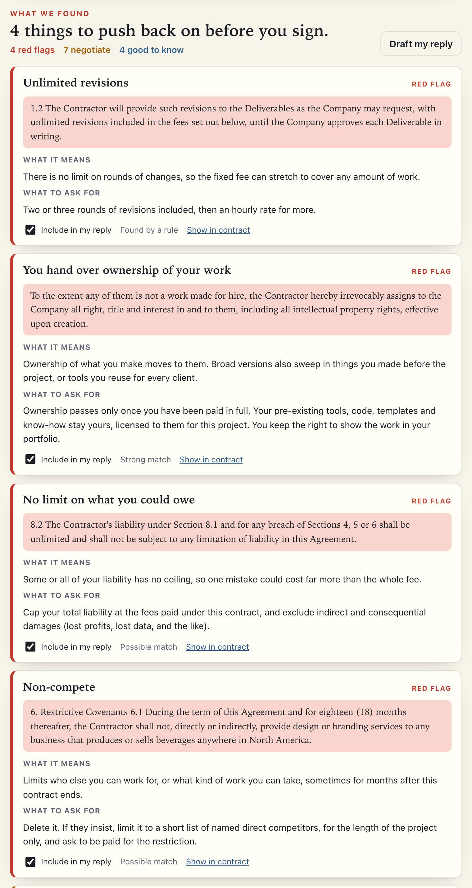

# Fine Print 🔍

Finds the clauses in a client contract that cost freelancers money, before you sign it.

Paste the contract or drop in the PDF. **EmbeddingGemma**, Google's open-weight embedding model, reads every clause in your browser, and a small classifier trained on 350 contracts that lawyers had marked up flags the ones to worry about: non-competes, IP grabs, no cap on what you could owe, penalties, auto-renewal, cancel-at-any-time and more. Each flag comes with what it means and what to ask for instead, and **Draft my reply** turns the ones you tick into an email to the client.

**Live:** https://fine-print-contracts.vercel.app · mirror: https://vanshajpoonia.github.io/fine-print/



## Why it runs on your device

Client contracts are confidential, often explicitly. Many say so in their own confidentiality clause, and pasting one into a hosted AI service means handing it to a third party. Fine Print never has the contract: the model is a file your browser downloads once, and the text never leaves the tab. Open the network tab and check.

It is also what makes this a viable one-person business. A tool that never receives its customers' contracts has nothing to leak, nothing to secure, and no per-scan cost, so it can be priced like a tool rather than like a lawyer.

## How it works

```
contract (paste, PDF, DOCX) ──► clauses ──► EmbeddingGemma (q4, in the browser) ──► 768 numbers per clause
                                src/segment.js   src/embed.js                              │
                                                                                            ▼
                        14 tiny classifiers, one per kind of clause (data/heads.json, 79 KB)
                        trained on CUAD's lawyer highlights by scripts/train.mjs
                                                                                            │
                                                                                            ▼
     flagged clauses ──► what it means, what to ask for, reply email: written by a person (src/flags.js)
     + 3 pattern checks CUAD has no category for: payment terms over 30 days, "to the Company's
       sole satisfaction", unlimited revisions (src/rules.js)
```

- **The model finds; people wrote the advice.** Nothing a freelancer reads is generated. A small model explaining a legal clause in its own words is exactly where you do not want invention, so the AI's only job is deciding which clauses to show you, and that job can be measured.
- **Segmentation** (`src/segment.js`) has to handle two very different inputs: real documents with hard-wrapped lines, and CUAD, where every contract is one long line with all whitespace collapsed. It splits on sentences and numbered clauses, keeps headings ("Non-Competition.") attached to their clause, and keeps offsets so the app can highlight the exact text.
- **The classifiers** are one logistic regression per flag on top of the embeddings, trained in plain JavaScript (`scripts/linear.mjs`), with each threshold chosen on validation contracts. In the browser, scoring a clause is 14 dot products.

## Data

[CUAD](https://www.atticusprojectai.org/cuad) (Contract Understanding Atticus Dataset, The Atticus Project, CC BY 4.0) is 510 real commercial contracts from SEC filings, with clauses in 41 categories highlighted by lawyers and law students. Fine Print's 14 flags use 16 of those categories (`src/flags.js` lists which). CUAD's official split is used as is: the 408 training contracts are split again into 350 to fit on and 58 to choose thresholds on, and the **102 test contracts are only used to test**.

## Measured

`npm test` runs the real model over all 102 held-out contracts (20,671 clauses, 824 of them highlighted by lawyers under one of the 14 flags) and scores three approaches the same way:

| Approach | Clauses found | Flags that were right | False alarms per contract | Contracts: found / right |
|---|---|---|---|---|
| Ctrl+F (hand-written keyword patterns) | 49% | 29% | 10.5 | 71% / 70% |
| Zero-shot (similarity to a one-line description) | 38% | 7% | 44.3 | 69% / 56% |
| **Trained heads on EmbeddingGemma (shipped)** | **66%** | **56%** | **4.6** | **83% / 78%** |

"Contracts: found / right" is the question a freelancer actually asks: does this contract have a non-compete? Of contracts where the lawyers marked one, how often Fine Print says so, and when it says so, how often it is right.

By flag (shipped):

| Flag | Clauses found | Right | Contracts found / right |
|---|---|---|---|
| Whose law, and where | 86/90 | 91% | 96% / 100% |
| No limit on what you could owe | 15/16 | 32% | 100% / 38% |
| You must carry insurance | 104/116 | 60% | 94% / 94% |
| Renews itself | 26/35 | 62% | 85% / 70% |
| They can inspect your records | 76/104 | 50% | 84% / 82% |
| Non-compete | 40/57 | 44% | 87% / 65% |
| There is a liability cap | 72/117 | 65% | 91% / 87% |
| Exclusivity | 41/78 | 43% | 76% / 78% |
| No-poach, no-solicit | 15/30 | 88% | 69% / 90% |
| They can cancel at any time | 18/41 | 49% | 62% / 69% |
| You can't criticise them | 5/12 | 35% | 71% / 36% |
| You give up the right to challenge them | 18/44 | 37% | 75% / 90% |
| You hand over ownership of your work | 22/61 | 61% | 74% / 74% |
| Fixed penalties | 5/23 | 38% | 36% / 63% |

What the table teaches:

- **Zero-shot is not a shortcut.** Describing a non-compete in one sentence and looking for similar clauses finds some, and drowns them in 44 false alarms per contract: to an embedding model, all legalese is similar to all other legalese.
- **Ctrl+F is a real baseline.** "governed by" finds governing law clauses fine. It falls apart on anything said in more than one way: a covenant not to sue is "shall not challenge", "shall not contest", "will not attack".
- **It is weakest on penalties and IP**, partly because CUAD's categories are broader than a freelancer's worry: its "IP ownership assignment" includes transferring domain names between companies.

### Not every false alarm is false

CUAD's annotators often highlight one instance of a clause per contract, so some "false alarms" are real clauses they did not mark. `node scripts/audit.mjs 40` prints 40 at random. Reading them: **8** are plainly the right kind of clause (a liability cap, an insurance requirement, an audit right), **12** are next to one (its heading, a carve-out, a recital), and **20** are plain mistakes (a press-release quote flagged as exclusivity). Every number above still counts all of them as wrong.

## Limits

- Scanned PDFs are pictures of text; Fine Print cannot read them (yet).
- English only. CUAD is US commercial contracts; a freelance contract under another country's law may phrase things differently.
- It points at clauses. It does not know your situation, and it can miss things. **Not legal advice.**

## Run it

```bash
npm start           # static server on :8000, no build step
npm install         # only for the scripts and tests
npm test            # unit checks, then the evaluation on CUAD's test set (downloads CUAD, 18 MB)
npm run train       # re-train data/heads.json (the test does this too, and checks it matches)
MODEL=bge npm test  # the same with bge-small
```

The first run embeds about 37,000 clauses and takes a while (about 40 minutes on an M4); embeddings are cached in `tests/.cache`.

## Files

```
src/segment.js     contract text -> clauses, with offsets
src/embed.js       the embedding models (shared by the browser and the scripts)
src/scan.js        clauses -> flags
src/flags.js       the 14 flags: which CUAD categories, what it means, what to ask for, reply line
src/rules.js       the 3 pattern checks
src/extract.js     PDF and DOCX to text, in the browser
src/model.js       EmbeddingGemma in the browser (WebGPU, or WASM)
src/app.js         UI
scripts/data.mjs   CUAD -> labelled clauses
scripts/train.mjs  fits the heads, chooses thresholds
scripts/measure.mjs  the scoring every approach shares
tests/unit.mjs     segmenter and rules, no model
tests/eval.mjs     the evaluation
data/heads.json    the trained heads
data/samples/      a freelance contract written for the demo, and one CUAD test contract with the lawyers' answers
```

## Credits

[CUAD](https://www.atticusprojectai.org/cuad) by The Atticus Project, CC BY 4.0. [EmbeddingGemma](https://huggingface.co/google/embeddinggemma-300m) by Google, under the [Gemma Terms of Use](https://ai.google.dev/gemma/terms), via the [ONNX build](https://huggingface.co/onnx-community/embeddinggemma-300m-ONNX). [bge-small-en-v1.5](https://huggingface.co/BAAI/bge-small-en-v1.5) by BAAI (MIT), for comparison. Runtime: [transformers.js](https://github.com/huggingface/transformers.js). PDF: pdf.js (Apache-2.0). DOCX: mammoth (BSD-2-Clause).

Code: MIT licence.
